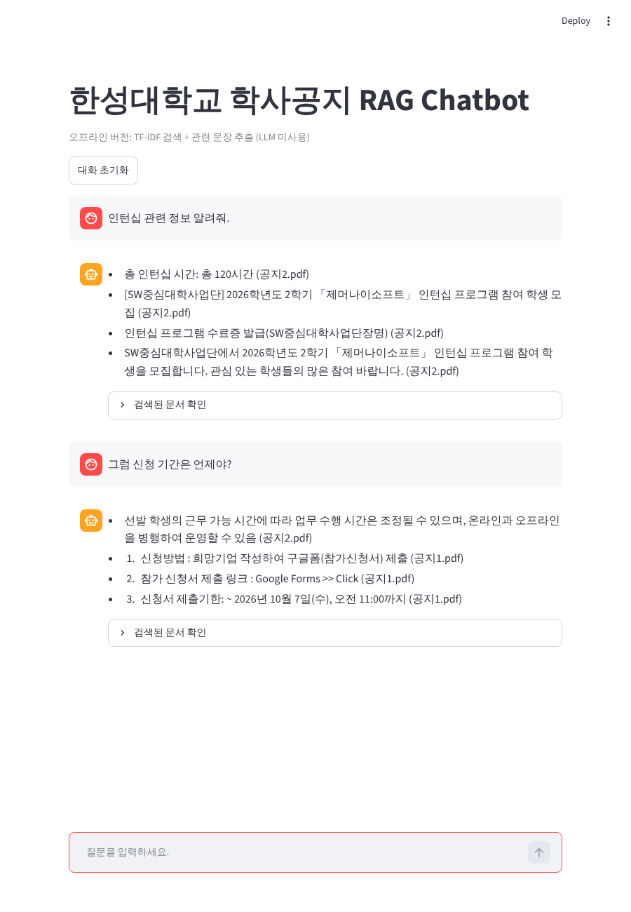
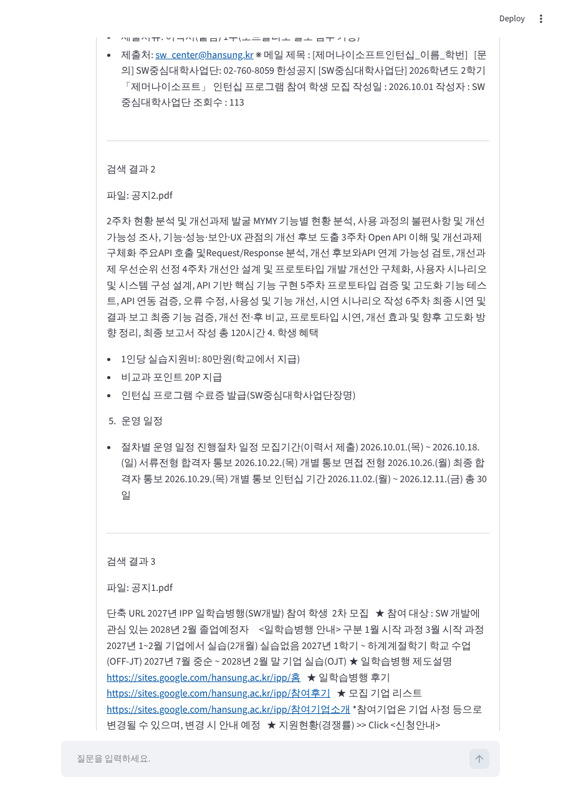

# 7주차 실행 및 결과 (오프라인 버전)

> **이 결과는 원본 실습(Ollama `gemma3:4b` + Hugging Face 임베딩)이 아닙니다.**
> 실행 환경에서 `ollama.com` / `huggingface.co` 접속이 차단되어 두 모델을 받을 수 없었기 때문에,
> 모델 없이 동작하도록 바꾼 **오프라인 버전**으로 실제 실행한 결과입니다. 출력은 모두 실제 실행 결과이며 수정하지 않았습니다.
> 원본 방식의 결과는 `../실행및결과.md`에 본인 PC에서 `run_all` 실행 후 채워 넣으세요.

## 원본과의 차이

| 구성 요소 | 원본 실습 | 오프라인 버전 |
| --- | --- | --- |
| PDF 로딩 / Chunk(700, overlap 100) / 검색 k=3 | 동일 | 동일 |
| Embedding + Vector DB | sentence-transformers + Chroma | TF-IDF(글자 2~3-gram), 코사인 유사도 |
| 답변 생성 | Ollama `gemma3:4b` | 검색된 문서에서 질문과 가까운 줄을 추출 (LLM 아님) |
| 대화형 Query | 직전 질문 + 현재 질문 | 동일 |
| UI | Streamlit (`pending_question` 2단계) | 동일 구조 (`app_offline.py`) |

## 한계 (솔직하게)
- 답변은 "생성"이 아니라 **문서 줄 발췌**라서 문장이 매끄럽지 않고, 질문 의도를 틀리게 고를 수 있습니다.
  예) STEP 3의 "신청 기간" 질문에 모집기간(2026.10.01~10.18)이 아니라 **인턴십 진행 기간**이 선택되었습니다.
- STEP 4에서 "신청 기간은?" 질문에는 공지1의 신청서 제출기한(10월 7일 11:00)이 나왔으나 공지2의 모집기간은 포함되지 않았습니다.
- 이런 부분은 임베딩과 LLM을 쓰는 원본 방식에서 개선되는 점이며, 오프라인 버전은 파이프라인 구조를 확인하는 용도입니다.

## STEP 2. 문서 검색 — `python step2_retrieval_offline.py`
- 동작: 공지 PDF 4페이지 → Chunk 8개 → TF-IDF → 질문과 가까운 Chunk 3개 검색

```text
데이터 폴더:
/home/user/opensource/6w/data

불러온 전체 페이지 수: 4
생성된 Chunk 수: 8

질문:
인턴십 관련 공지의 주요 내용은 무엇인가요?

========== 검색 결과 1 (유사도 0.125) ==========
파일: 공지2.pdf
페이지: 0

문서 내용:
면접 전형 2026.10.26.(월)
최종 합격자 통보 2026.10.29.(목) 개별 통보
인턴십 기간 2026.11.02.(월) ~ 2026.12.11.(금) 총 30일
※ 선발 학생의 근무 가능 시간에 따라 업무 수행 시간은 조정될 수 있으며, 온라인과 오프라인을 병행하여 운영할 수 있음
- 총 인턴십 시간: 총 120시간
 
6. 제출서류
- 제출서류: 이력서(붙임) 1부(포트폴리오 별도 첨부 가능)
- 제출처: sw_center@hansung.kr
※ 메일 제목 : [제머나이소프트인턴십_이름_학번]
 
[문의]
SW중심대학사업단: 02-760-8059
한성공지
[SW중심대학사업단] 2026학년도 2학기 「제머나이소프트」 인턴십 프로그램 참여 학생 모집
작성일 : 2026.10.01 작성자 : SW중심대학사업단 조회수 : 113

========== 검색 결과 2 (유사도 0.081) ==========
파일: 공지2.pdf
페이지: 0

문서 내용:
- RESTful API 연동 기초 역량 보유자(HTTP 통신, JSON 처리, API 키 인증)
- 백엔드 개발 언어 1개 이상 활용 가능자(Node.js 또는 Python)
우대사항
- 웹 프론트엔드 기초 경험자(React 등)
- AI(LLM, RAG, 임베딩), Webhook, 보안 도구 경험자
- 미디어 검색·추천, 그래프·지도·얼굴인식 API 활용 프로젝트 경험자
 
3. 실습내용
실습기관 부서명 개발부서
직무명 Open API를 활용한 MYMY 미디어아카이브(MAM) 개선
교육목표 미디어 자산관리 플랫폼과 open API를 다루며 문제정의-분석/개발-검증-보고의 전 과정을 경험한다
직무개요
제머나이소프트 자사의 MYMY 미디어아카이브(MAM) 솔루션을 직접 사용·분석하여 기능·성능·보안·UX 개선 아이디어를 도출하고,
제공된 API를 활용하여 개선사항을 설계·구현한 후 시연까지 수행한다.
구분/주차 직무교육 내용 실습 내용
1주차 MYMY 솔루션 이해 및 기본 사용 실습 계정 생성, MYMY 주요 기능 직접 사용, 기본 검색·조회 실습, 사용자
관점에서 기능 및 사용 흐름 파악
2주차 현황 분석 및 개선과제 발굴
MYMY 기능별 현황 분석, 사용 과정의 불편사항 및 개선 가능성 조사,
기능·성능·보안·UX 관점의 개선 후보 도출

========== 검색 결과 3 (유사도 0.070) ==========
파일: 공지1.pdf
페이지: 0

문서 내용:
4. 이력서 제출기한: ~ 2026년 10월 7일(수),  22:00까지 (제출메일은 기업배정 시 문자로 개별 안내 예정)
※ 이력서 다운로드 사이트 >> Click   *1지망 기준으로 미리 작성 바람
※ 자기소개서 특강 동영상 필수 시청 >> Click
※ 이력서 작성에 도움이 필요한 학생들은 상상관 지하 1층 대학일자리플러스센터에서 상담을 받아보시는걸 추천드립니다.
※ 참가신청서는 제출 후 수정이 불가하니 신중하게 제출하시기 바랍니다.
<향후 일정>
일자 10월7일 (수) ~10월7일(수), 22:00까지 10월8일(목), 14:30
내용 지원기업 배정
이력서, 자기소개서 제출
*담당 교수님께 제출 예정
[필참]
OT / 이력서 컨설팅
(상담/모의면접)
- 기업면접 : 2026년 10월 중순 진행 예정
- 그 외 기타 일정은 추후 공지 예정
* 상기 일정은 변경될 수 있으며, 변경 시 문자 및 공지로 안내 예정
<상담부스 운영 일정>
일정 시간 장소 비고
*9월 29일(화)
10:30 ~ 12:00
13:00 ~ 16:00
공학관 A동
상상파크 플러스
*9월29일(화)
IPP사업단 교수진 상담진행으로
참여기업 상담도 가능함
9월 30일(수) 10:00 ~ 12:00
한성공지
2027년 IPP 일학습병행(SW개발) 참여 학생 2차 모집
작성일 : 2026.09.28 작성자 : IPP사업단 조회수 : 225
```

## STEP 3. Basic RAG — `python step3_basic_rag_offline.py`
- 동작: 검색된 Chunk에서 질문과 유사한 줄을 골라 답변 구성 (이전 대화 미사용)

```text

========== 검색된 실제 내용 ==========

[검색 결과 1]
파일: 공지2.pdf
페이지: 0
면접 전형 2026.10.26.(월)
최종 합격자 통보 2026.10.29.(목) 개별 통보
인턴십 기간 2026.11.02.(월) ~ 2026.12.11.(금) 총 30일
※ 선발 학생의 근무 가능 시간에 따라 업무 수행 시간은 조정될 수 있으며, 온라인과 오프라인을 병행하여 운영할 수 있음
- 총 인턴십 시간: 총 120시간
 
6. 제출서류
- 제출서류: 이력서(붙임) 1부(포트폴리오 별도 첨부 가능)
- 제출처: sw_center@hansung.kr
※ 메일 제목 : [제머나이소프트인턴십_이름_학번]
 
[문의]
SW중심대학사업단: 02-760-8059
한성공지
[SW중심대학사업단] 2026학년도 2학기 「제머나이소프트」 인턴십 프로그램 참여 학생 모집
작성일 : 2026.10.01 작성자 : SW중심대학사업단 조회수 : 113

[검색 결과 2]
파일: 공지2.pdf
페이지: 0
2주차 현황 분석 및 개선과제 발굴
MYMY 기능별 현황 분석, 사용 과정의 불편사항 및 개선 가능성 조사,
기능·성능·보안·UX 관점의 개선 후보 도출
3주차 Open API 이해 및 개선과제 구체화 주요API 호출 및Request/Response 분석, 개선 후보와API 연계 가능성 검토,
개선과제 우선순위 선정
4주차 개선안 설계 및 프로토타입 개발
개선안 구체화, 사용자 시나리오 및 시스템
구성 설계, API 기반 핵심 기능 구현
5주차 프로토타입 검증 및 고도화
기능 테스트, API 연동 검증, 오류 수정,
사용성 및 기능 개선, 시연 시나리오 작성
6주차 최종 시연 및 결과 보고
최종 기능 검증, 개선 전·후 비교, 프로토타입 시연, 개선 효과 및 향후
고도화 방향 정리, 최종 보고서 작성
총 120시간
4. 학생 혜택
- 1인당 실습지원비: 80만원(학교에서 지급)
- 비교과 포인트 20P 지급
- 인턴십 프로그램 수료증 발급(SW중심대학사업단장명)
 
5. 운영 일정
- 절차별 운영 일정
진행절차 일정
모집기간(이력서 제출) 2026.10.01.(목) ~ 2026.10.18.(일)
서류전형 합격자 통보 2026.10.22.(목) 개별 통보
면접 전형 2026.10.26.(월)
최종 합격자 통보 2026.10.29.(목) 개별 통보
인턴십 기간 2026.11.02.(월) ~ 2026.12.11.(금) 총 30일

[검색 결과 3]
파일: 공지1.pdf
페이지: 0
단축 URL
2027년 IPP 일학습병행(SW개발) 참여 학생  2차 모집
 
★ 참여 대상 : SW 개발에 관심 있는 2028년 2월 졸업예정자
 
  <일학습병행 안내>
구분 1월 시작 과정 3월 시작 과정
2027년 1~2월 기업에서 실습(2개월) 실습없음
2027년 1학기 ~ 하계계절학기 학교 수업(OFF-JT)
2027년 7월 중순 ~ 2028년 2월 말 기업 실습(OJT)
★ 일학습병행 제도설명
https://sites.google.com/hansung.ac.kr/ipp/홈
 
★ 일학습병행 후기
https://sites.google.com/hansung.ac.kr/ipp/참여후기
 
★ 모집 기업 리스트
https://sites.google.com/hansung.ac.kr/ipp/참여기업소개
*참여기업은 기업 사정 등으로 변경될 수 있으며, 변경 시 안내 예정
 
★ 지원현황(경쟁률) >> Click
<신청안내>
1. 신청방법 : 희망기업 작성하여 구글폼(참가신청서) 제출
 
2. 참가 신청서 제출 링크 : Google Forms >> Click
3. 신청서 제출기한: ~ 2026년 10월 7일(수), 오전 11:00까지  
4. 이력서 제출기한: ~ 2026년 10월 7일(수),  22:00까지 (제출메일은 기업배정 시 문자로 개별 안내 예정)
======================================

질문:
인턴십 신청 기간은 언제인가요?

검색된 문서:
- 공지2.pdf
- 공지2.pdf
- 공지1.pdf

RAG 답변:
- 인턴십 기간 2026.11.02.(월) ~ 2026.12.11.(금) 총 30일  (공지2.pdf)
- 총 인턴십 시간: 총 120시간  (공지2.pdf)
- [SW중심대학사업단] 2026학년도 2학기 「제머나이소프트」 인턴십 프로그램 참여 학생 모집  (공지2.pdf)
- 인턴십 프로그램 수료증 발급(SW중심대학사업단장명)  (공지2.pdf)
```

## STEP 4. 대화형 RAG — `python step4_chat_rag_offline.py < questions.txt`
- 동작: 직전 질문 + 현재 질문으로 검색. "그럼 신청 기간은 언제야?" 처럼 짧은 후속 질문도 `[검색 Query]`에 이전 질문이 포함됩니다.
- 마지막 질문("급여는 얼마야?")은 문서에 없는 내용이라 "확인할 수 없습니다"로 답합니다.

```text
대화형 RAG Chatbot (오프라인 버전)
종료하려면 exit를 입력하세요.

사용자: 인턴십 관련 정보 알려줘.

[검색 Query]
인턴십 관련 정보 알려줘.
[검색된 문서] 공지2.pdf p.0, 공지2.pdf p.0, 공지2.pdf p.0

AI:
- 총 인턴십 시간: 총 120시간  (공지2.pdf)
- [SW중심대학사업단] 2026학년도 2학기 「제머나이소프트」 인턴십 프로그램 참여 학생 모집  (공지2.pdf)
- 인턴십 프로그램 수료증 발급(SW중심대학사업단장명)  (공지2.pdf)
- SW중심대학사업단에서 2026학년도 2학기 「제머나이소프트」 인턴십 프로그램 참여 학생을 모집합니다. 관심 있는 학생들의 많은 참여 바랍니다.  (공지2.pdf)

사용자: 그럼 신청 기간은 언제야?

[검색 Query]
이전 질문:
인턴십 관련 정보 알려줘.

현재 질문:
그럼 신청 기간은 언제야?

[검색된 문서] 공지2.pdf p.0, 공지2.pdf p.0, 공지1.pdf p.0

AI:
- 선발 학생의 근무 가능 시간에 따라 업무 수행 시간은 조정될 수 있으며, 온라인과 오프라인을 병행하여 운영할 수 있음  (공지2.pdf)
- 1. 신청방법 : 희망기업 작성하여 구글폼(참가신청서) 제출  (공지1.pdf)
- 2. 참가 신청서 제출 링크 : Google Forms >> Click  (공지1.pdf)
- 3. 신청서 제출기한: ~ 2026년 10월 7일(수), 오전 11:00까지  (공지1.pdf)

사용자: 제출 방법은?

[검색 Query]
이전 질문:
그럼 신청 기간은 언제야?

현재 질문:
제출 방법은?

[검색된 문서] 공지1.pdf p.0, 공지1.pdf p.0, 공지2.pdf p.0

AI:
- 1. 신청방법 : 희망기업 작성하여 구글폼(참가신청서) 제출  (공지1.pdf)
- 참가신청서는 제출 후 수정이 불가하니 신중하게 제출하시기 바랍니다.  (공지1.pdf)
- 이력서, 자기소개서 제출  (공지1.pdf)
- 담당 교수님께 제출 예정  (공지1.pdf)

사용자: 급여는 얼마야?

[검색 Query]
이전 질문:
제출 방법은?

현재 질문:
급여는 얼마야?

[검색된 문서] 공지1.pdf p.0, 공지2.pdf p.0, 공지1.pdf p.0

AI:
제공된 문서에서 확인할 수 없습니다.

사용자:
```

## STEP 5. Streamlit Chat UI — `streamlit run app_offline.py`
- 동작: 질문 입력 → `pending_question` 저장 → rerun(입력창 숨김) → 검색 + 답변 → 저장 → rerun(입력창 복귀)
- 실제 브라우저(Chromium)로 접속해 질문 2개를 입력한 화면입니다.



"검색된 문서 확인"을 펼친 화면:



## 실행 방법
```bash
cd 7w/offline
python3 -m venv .venv && source .venv/bin/activate
pip install -r requirements-offline.txt
./run_all_offline.sh          # STEP 2~4, 결과는 outputs/ 에 저장
streamlit run app_offline.py  # STEP 5
```
